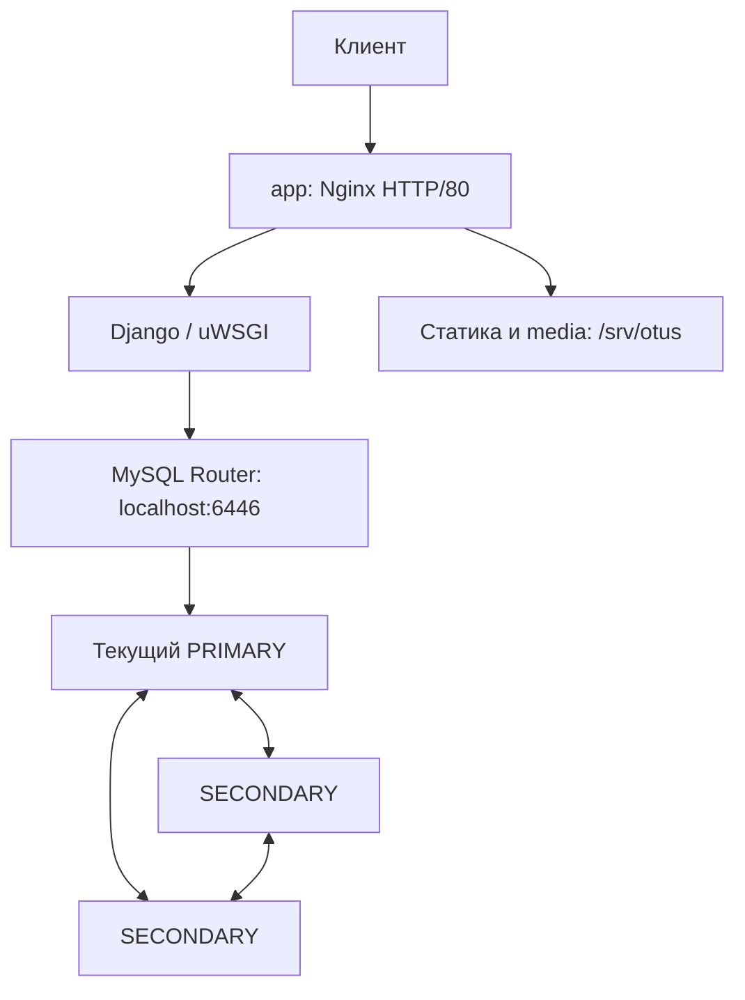

# ДЗ05. Отказоустойчивый кластер MySQL

## Цель работы

Развернуть отказоустойчивую базу данных веб-проекта, создать схему и загрузить
данные. Проверить работу приложения при отказе одного узла БД и после его
восстановления. Подготовить воспроизводимое развёртывание, проверки и удаление.

## Реализованное решение

Портал «База знаний домашних заданий OTUS» работает на Django и uWSGI
с MySQL InnoDB Cluster из трёх узлов. На отдельной ВМ приложения установлены
Nginx и MySQL Router. Terraform создаёт инфраструктуру Selectel,
Python-скрипты настраивают серверы, загружают данные и выполняют проверки.

## Архитектура



| Узлы | Количество | vCPU / RAM на ВМ | Диск на ВМ | Назначение |
| --- | ---: | --- | --- | --- |
| db1, db2, db3 | 3 | 2 / 4 ГиБ | SSD 20 ГБ | Реплики MySQL, одна принимает запись |
| app | 1 | 1 / 2 ГиБ | SSD 20 ГБ | Nginx, Django/uWSGI, Router, static и media |

Стенд использует 7 vCPU, 14 ГиБ RAM, 80 ГБ SSD и один публичный IPv4
в Selectel ru-9a. Правило anti-affinity размещает ВМ БД на разных физических
хостах. Сеть 10.55.0.0/24, префикс otus-dz05, state и ключи отдельные.
БД otus хранится на дисках узлов MySQL; media находится на app и резервируется
отдельно от базы. Код приложения размещён в /opt/otus-dz05.

## Обоснование выбора

Selectel используется как среда выполнения задания. InnoDB Cluster объединяет
Group Replication, MySQL Shell AdminAPI для настройки кластера и Router
для подключения приложения к текущему узлу записи. В режиме single-primary
запись обслуживает один PRIMARY, а большинство из двух узлов позволяет
выбрать новый PRIMARY при отказе третьего. Django сохраняет один адрес
подключения через Router. [Официальное описание InnoDB Cluster](https://dev.mysql.com/doc/refman/8.0/en/mysql-innodb-cluster-introduction.html).

## Соответствие заданию

| Требование | Реализация и подтверждение |
| --- | --- |
| Отказоустойчивый MySQL | Три узла InnoDB Cluster; [отказ PRIMARY/SECONDARY и возврат](docs/results.md) |
| БД веб-проекта и данные | Django migrate/loaddata; [восстановлены четыре статьи из исходников](docs/migration.md), исторический дамп отсутствует |
| Автоматизация, инструкции и логи | [Terraform](terraform-selectel/), [скрипты](scripts/), [инструкция](docs/operations.md), [журнал](docs/verification.log) |
| Результат в Git | Код и обезличенные доказательства в ветке mysqlcluster; секреты и state исключены |

## Запуск и проверка

Управляющее рабочее место проверено на Windows с PowerShell, Python 3.14.2
и Terraform 1.16.3. Полная [инструкция подготовки](docs/operations.md) описывает
оператора Selectel, инструменты, ключи, параметры и Terraform init.
Для уже подготовленного каталога используется короткая последовательность ниже.
Все команды выполняются по очереди локально в PowerShell из корня репозитория.

Подготовленный каталог содержит `.tools/venv/Scripts/python.exe`,
`.tools/terraform.exe`, `.local/otus_dz05`, `.local/otus_dz05.pub`,
`terraform-selectel/terraform.tfvars.json` и инициализированный Terraform.
Managed state должен быть пустым. Скрипт ввода credentials запрашивает
недостающие данные оператора и пароль; регион по умолчанию ru-9.

```powershell
# Ввести credentials
. .\scripts\selectel-env.ps1
.\scripts\save-operator.ps1

# Развернуть
.\.tools\venv\Scripts\python.exe scripts/lab.py deploy

# Проверить приложение, отказы и восстановление
.\.tools\venv\Scripts\python.exe scripts/lab.py verify

# Получить адрес портала и открыть браузер
$lab = Get-Content .\.local\lab.json -Raw | ConvertFrom-Json
$portalUrl = 'http://' + $lab.app_public_ip
$portalUrl
Start-Process $portalUrl
```

После проверки портала в браузере:

```powershell
# Удалить — также выполнить при ошибке deploy или verify
.\.tools\venv\Scripts\python.exe scripts/lab.py destroy
if ($LASTEXITCODE -ne 0) { throw 'Удаление не подтверждено; credentials и state сохранить для повторной очистки' }

# Только после успешного destroy удалить локальные credentials
Remove-Item -LiteralPath .\.local\operator.json
Remove-Item Env:OS_PASSWORD -ErrorAction SilentlyContinue
```

Если destroy завершился ошибкой, credentials и state сохраняются до успешной
очистки. deploy создаёт платные ресурсы и оставляет сервис работающим;
повторный deploy поверх существующего стенда отклоняется. verify временно
останавливает по одному узлу БД и восстанавливает его. destroy необратимо
удаляет ВМ, базу и media; остановка ВМ сохраняет диски и расходы.

Ожидаются APPLICATION READY после deploy и LIVE VERIFICATION PASSED после verify.
В браузере доступны четыре материала и страницы статей. verify проверяет
admin и media через HTTP внутри SSH-туннеля. [Порядок проверок](docs/testing.md).

## Результаты

Проверены импорт четырёх статей, идентификаторы и права Django, пять тестов
на MySQL, HTTP портала, создание статьи и загрузка изображения через admin.
При остановке PRIMARY оставшиеся узлы выбрали новый PRIMARY и обслуживали
чтение и запись через тот же Router. Отказ SECONDARY также прошёл проверку.
После каждого возврата все три узла стали ONLINE; подтверждённые записи
сохранились, контрольные суммы статей на репликах совпали.

Результаты приведены в [отчёте](docs/results.md) и
[обезличенном JSON](docs/verification-20261019T190833Z.json).
Удаление подтверждено пустым state и [API-аудитом](docs/cleanup-latest.json).

## Ограничения

Граница отказоустойчивости — одна ВМ БД в одной зоне. app, Router и media
остаются единой точкой отказа; потеря двух узлов БД лишает кластер большинства.
При смене PRIMARY возможен краткий ответ 503 и ошибка незавершённой транзакции.
Публичное чтение использует HTTP; административная проверка — SSH-туннель.
Внешний и внутренний SSH используют TCP/22. Доступ снаружи ограничен
подтверждёнными IPv4 оператора /32; адрес определяется при развёртывании.

Исторический дамп PostgreSQL ДЗ04 не найден. Данные восстановлены из исходного
seed_lessons, экспортированы dumpdata и импортированы loaddata. Это
реконструкция исходных материалов, а не перенос исторической PostgreSQL БД.
[Происхождение данных](docs/reconstruction.json).

## Структура репозитория

| Каталог или файл | Назначение |
| --- | --- |
| [app/](app/) | Портал, модели, миграции и тесты Django |
| [terraform-selectel/](terraform-selectel/) | Инфраструктура, lock-файл и пример параметров |
| [scripts/](scripts/) | Подготовка, настройка, проверка и удаление |
| [config/](config/) | Шаблон подписанной пробы сетевого маршрута |
| [docs/operations.md](docs/operations.md) | Подготовка и полная инструкция запуска |
| [docs/migration.md](docs/migration.md) | Экспорт, импорт, права и media |
| [docs/compatibility.md](docs/compatibility.md) | Совместимость приложения с MySQL |
| [docs/resources.md](docs/resources.md) | Состав ресурсов |
| [docs/results.md](docs/results.md) | Подтверждённые результаты |

Локальные .tools/ и .local/ исключены из Git. Credentials, ключи, реальные
параметры, state, дампы и полные локальные журналы не публикуются.
Порядок проверки состава публикации описан в [инструкции](docs/operations.md#дополнительные-проверки).
