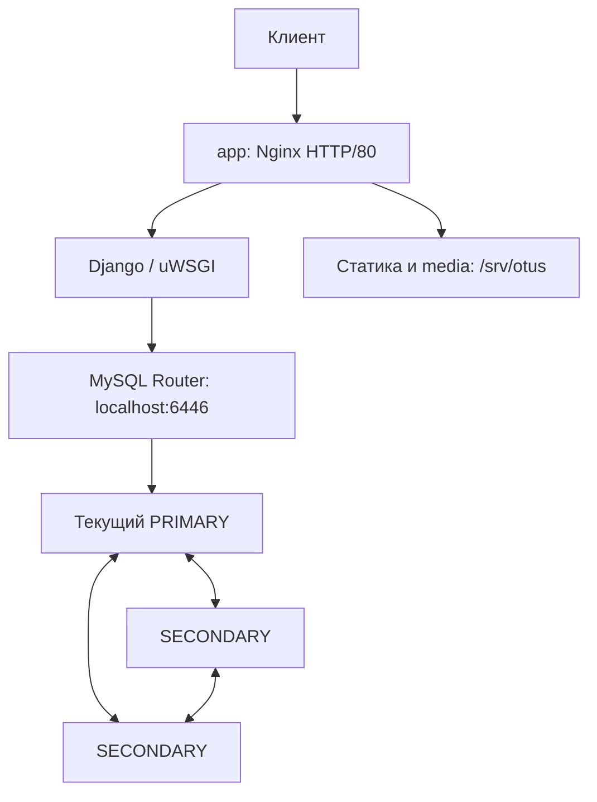

# ДЗ05. Отказоустойчивый кластер MySQL

## Цель работы

Развернуть отказоустойчивую базу данных веб-проекта, создать схему и загрузить
данные. Проверить работу приложения при отказе одного узла БД и после его
восстановления. Подготовить воспроизводимое развёртывание, проверки и удаление.

## Реализованное решение

Портал «База знаний домашних заданий OTUS» работает на Django и uWSGI
с MySQL InnoDB Cluster из трёх узлов. На отдельной ВМ приложения установлены
Nginx и MySQL Router. Terraform создаёт инфраструктуру Selectel, Ansible-роли
настраивают серверы и загружают данные. Python управляет этапами и выполняет
отдельные проверки приложения и отказоустойчивости.

## Архитектура



| Узлы | Количество | vCPU / RAM на ВМ | Диск на ВМ | Назначение |
| --- | ---: | --- | --- | --- |
| db1, db2, db3 | 3 | 2 / 4 ГиБ | SSD 20 ГБ | Реплики MySQL, одна принимает запись |
| app | 1 | 1 / 2 ГиБ | SSD 20 ГБ | Nginx, Django/uWSGI, Router, static и media |

Стенд использует 7 vCPU, 14 ГиБ RAM, 80 ГБ SSD и один публичный IPv4
в выбранном пуле Selectel. Правило anti-affinity размещает ВМ БД на разных физических
хостах. Сеть 10.55.0.0/24, префикс otus-dz05, state и ключи отдельные.
БД otus хранится на дисках узлов MySQL; media находится на app и резервируется
отдельно от базы. Код приложения размещён в /opt/otus-dz05.

## Обоснование выбора

Selectel используется как среда выполнения задания. InnoDB Cluster объединяет
Group Replication, MySQL Shell AdminAPI для настройки кластера и Router
для подключения приложения к текущему узлу записи. В режиме single-primary
запись обслуживает один PRIMARY, а большинство из двух узлов позволяет
выбрать новый PRIMARY при отказе третьего. Django сохраняет один адрес
подключения через Router. [Официальное описание InnoDB Cluster](https://dev.mysql.com/doc/refman/8.0/en/mysql-innodb-cluster-introduction.html).

## Соответствие заданию

| Требование | Реализация и подтверждение |
| --- | --- |
| Отказоустойчивый MySQL | Три узла InnoDB Cluster; [отказ PRIMARY/SECONDARY и возврат](docs/results.md) |
| БД веб-проекта и данные | Django migrate/loaddata; [начальные данные из материалов ДЗ04](docs/migration.md) |
| Автоматизация, инструкции и логи | [Terraform](terraform-selectel/), [скрипты](scripts/), [инструкция](docs/operations.md), [журнал](docs/verification.log) |
| Результат в Git | Код и обезличенные доказательства в ветке mysqlcluster; секреты и state исключены |

## Пошаговое развёртывание и проверка

Все команды выполняются локально в PowerShell из корня клона. Нужны Python
3.12+, Git, OpenSSH и установленный Terraform 1.6–1.x. Подготовка создаёт
собственные `.tools/venv` и `.tools/terraform.exe`, устанавливает зависимости;
доступ к каталогам других ДЗ не требуется.

Ansible выполняется на существующей ВМ app с Ubuntu 24.04 и Python 3.12.
Deploy автоматически готовит защищённый venv контроллера с ansible-core 2.20.10,
проверяет playbook и запускает роли. Установка WSL/Docker на рабочем месте
и отдельная управляющая ВМ не требуются. [Подготовка контроллера](docs/ansible.md).

```powershell
# Однократно; Terraform должен быть в PATH
.\scripts\setup.ps1
# Если его нет в PATH, вместо предыдущей команды:
# .\scripts\setup.ps1 -TerraformPath C:\Tools\terraform.exe
```

**1. Credentials.** Выбрать один вариант в той же сессии.

Ввод без сохранения — для ревью:

```powershell
. .\scripts\env.ps1
```

Либо ввод с явным сохранением — для разработки:

```powershell
. .\scripts\env.ps1 -SaveLocal
```

Либо явная загрузка ранее сохранённого файла:

```powershell
. .\scripts\env.ps1 -Development
# Равнозначный явный alias: . .\scripts\env.ps1 -Dev
```

`-SaveLocal` и `-Development` взаимоисключающие. Файл `.local/operator.json`
исключён из Git; PowerShell проверяет владельца и отсутствие разрешений другим
пользователям до загрузки. Пароль вводится скрыто. Схема полей находится в
`config/selectel-auth.json`; Python и Terraform получают реквизиты только из
окружения процесса. `OTUS_SELECTEL_AUTH` не является источником реквизитов.

Основная последовательность эксплуатации — в той же сессии PowerShell.
Команды выполняются по отдельности; стенд остаётся работать до явного destroy.

**2. Deploy.** Создать стенд или повторно применить конфигурацию:

```powershell
.\.tools\venv\Scripts\python.exe scripts/lab.py deploy
if ($LASTEXITCODE -ne 0) { throw 'deploy failed: сохраните данные и изучите диагностику' }
```

**3. Verify.** Проверить приложение, отказ и восстановление узлов:

```powershell
.\.tools\venv\Scripts\python.exe scripts/lab.py verify
if ($LASTEXITCODE -ne 0) { throw 'verify failed: сохраните стенд для диагностики' }
```

**4. Open.** Вывести размещение и URL, открыть портал для ручной проверки:

```powershell
.\.tools\venv\Scripts\python.exe scripts/lab.py open
```

`open` не требует credentials и облачного API: сверяет привязку, ID ВМ и адрес
с локальным state. При отсутствии или несовпадении данных завершается ошибкой.
Доступность сервиса по сети проверяется отдельно браузером и verify.

Повторный deploy применяет конфигурацию существующего стенда. Добавление БД
в nodes создаёт только ресурсы нового узла; удаление, замена и изменение
существующих ресурсов блокируются до apply. Начальная фикстура повторно
не загружается: её загрузка и постоянный маркер в БД фиксируются одной
транзакцией. Отсутствие маркера на существующем стенде не перезаписывает данные.
Ошибка настройки или расширения сохраняет state, контекст,
ключи и диагностику; исправление продолжается повторным deploy.
[Сценарий добавления узла и границы проверки](docs/expansion.md).

**5. Destroy.** Отдельное необратимое удаление, только когда стенд больше не нужен:

```powershell
.\.tools\venv\Scripts\python.exe scripts/lab.py destroy
if ($LASTEXITCODE -ne 0) { throw 'Удаление не подтверждено: сохраните state, контекст и ключи, повторите destroy' }
```

**6. Очистка credentials.** Только после подтверждённого успешного destroy:

```powershell
# Только после успешного destroy — отдельное удаление credentials разработки
Remove-Item -LiteralPath .\.local\operator.json -ErrorAction SilentlyContinue
. .\scripts\env.ps1 -Clear
```

Успешный destroy подтверждает пустой state и отсутствие собственных ресурсов
через облачный API, затем удаляет служебный контекст, ключи, секреты приложения,
планы, локальные журналы, пустой state и резервные копии. Несекретные настройки
и файл credentials разработки сохраняются; последний удаляется отдельной
командой выше. При ошибке удаления данные восстановления сохраняются.
Рабочий каталог `.local` не предназначен для личных документов. Очистка
отклоняет ссылки и пути за пределами клона. Обезличенные доказательства
остаются в `docs/`. Остановка ВМ не заменяет destroy.

ДЗ05 использует `.local/lab-config.json` из `config/lab.example.json`: порядок
пулов и автоматический выбор сегмента, очистка перед повторной попыткой размещения.

Локальные проверки нового интерфейса описаны в [отчёте](docs/local-management.md).
Сохранённые ручные прогоны подтверждают ранее проверенный стенд. Расширение
и новый временный цикл проверены локально; их облачная приёмка ещё не выполнена.

## Временное полное испытание — уничтожает тестовый стенд

Выполнять из каталога клона. Сначала подготовить окружение и пройти локальные
проверки; эти команды не создают облачные ресурсы:

```powershell
.\scripts\setup.ps1
.\.tools\venv\Scripts\python.exe scripts/check_ansible.py
if ($LASTEXITCODE -ne 0) { throw 'Ошибка статической проверки Ansible' }
.\.tools\venv\Scripts\python.exe -m unittest discover -s tests
if ($LASTEXITCODE -ne 0) { throw 'Ошибка локальных тестов' }
powershell -NoProfile -File .\tests\test_credentials.ps1
if ($LASTEXITCODE -ne 0) { throw 'Ошибка проверки credentials' }
```

Terraform должен быть доступен через PATH или `.tools`; при необходимости
передать его путь в setup: ` .\scripts\setup.ps1 -TerraformPath C:\Tools\terraform.exe`.
Статическая проверка Ansible и mock-тесты не подтверждают работу в облаке.

Затем выбрать **один** способ заполнения окружения:

```powershell
# Без сохранения реквизитов
. .\scripts\env.ps1

# Либо ввод с явным сохранением для разработки
. .\scripts\env.ps1 -SaveLocal

# Либо загрузка ранее сохранённых реквизитов (-Development — полное имя ключа)
. .\scripts\env.ps1 -Dev
```

Следующая команда создаёт платные ресурсы и уничтожает созданный тестовый
стенд. Запускать только без действующего стенда и незавершённых операций:

```powershell
.\.tools\venv\Scripts\python.exe scripts/lab.py test-cycle
$cycleExitCode = $LASTEXITCODE
```

Цикл создаёт свой стенд, проверяет отказы, записывает контрольную статью с media,
повторяет deploy, добавляет узел, сверяет ID и данные, повторяет deploy после
расширения. В finally удаляет только собственный тестовый стенд и подтверждает
очистку через state и API. Credentials не удаляются автоматически.
Существующий контекст или непустой state блокируют цикл до изменений.
При ошибке очистки данные восстановления сохраняются. После принудительного
закрытия процесса finally не гарантирован: восстановить окружение и выполнить
destroy вручную из того же клона. [Подробности и критерий готовности](docs/expansion.md).

После завершения, включая завершение с ошибкой, просмотреть отчёты текущего
запуска. Проверить время отчётов: сохранённые результаты предыдущего прогона
не подтверждают результат нового запуска.

```powershell
$cycle = Get-Content .\docs\cycle-latest.json -Raw | ConvertFrom-Json
$cycle | Select-Object started_utc, finished_utc, success, cleanup_success, steps, error_type
$cycle.expansion
$cleanup = Get-Content .\docs\cleanup-latest.json -Raw | ConvertFrom-Json
$cleanup
```

Успешное испытание: код завершения `$cycleExitCode` равен `0`, `success` и
`cleanup_success` равны `true`; отчёт расширения подтверждает сохранение ID,
данных и media, присоединение нового узла и работу приложения. Подтверждение
удаления: `own_state_empty` равен `true`, все значения `remaining_by_prefix`
равны `0`. При ошибке испытания изучить отчёт; при неподтверждённой очистке
сохранить реквизиты, state, контекст, ключи и диагностику для повторного destroy.

**Только после подтверждённой очистки** удалить сохранённые credentials, если
создавались, и очистить окружение текущего PowerShell:

```powershell
Remove-Item -LiteralPath .\.local\operator.json -ErrorAction SilentlyContinue
. .\scripts\env.ps1 -Clear
```

## Результаты

Последний ручной прогон подтвердил загрузку пяти статей, идентификаторы и права
Django, HTTP портала, создание статьи и загрузку изображения через admin.
При остановке PRIMARY оставшиеся узлы выбрали новый PRIMARY и обслуживали
чтение и запись через тот же Router. Отказ SECONDARY также прошёл проверку.
После каждого возврата все три узла стали ONLINE; подтверждённые записи
сохранились, контрольные суммы статей на репликах совпали.

Ручной прогон с SSH/22 успешно завершён в пуле ru-9.
Результаты приведены в [отчёте](docs/results.md) и
[обезличенном JSON](docs/verification-20261020T201205Z.json).
Удаление подтверждено пустым state и [API-аудитом](docs/cleanup-latest.json).
Повторное применение и расширение требуют отдельной облачной приёмки.

## Ограничения

Граница отказоустойчивости — одна ВМ БД в одной зоне. app, Router и media
остаются единой точкой отказа; потеря двух узлов БД лишает кластер большинства.
При смене PRIMARY возможен краткий ответ 503 и ошибка незавершённой транзакции.
Публичное чтение использует HTTP; административная проверка — SSH-туннель.
Внешний и внутренний SSH используют TCP/22. Доступ снаружи ограничен
подтверждёнными IPv4 оператора /32; адрес определяется при развёртывании.

Начальные данные подготовлены по материалам ДЗ04 и загружаются Django-фикстурой.
Схема создаётся миграциями. [Порядок загрузки](docs/migration.md).

## Структура репозитория

| Каталог или файл | Назначение |
| --- | --- |
| [app/](app/) | Портал, модели, миграции и тесты Django |
| [terraform-selectel/](terraform-selectel/) | Инфраструктура, lock-файл и пример параметров |
| [scripts/](scripts/) | Подготовка, оркестрация, проверки и удаление |
| [ansible/](ansible/) | Обязательные роли настройки серверов |
| [config/](config/) | Шаблон подписанной пробы сетевого маршрута |
| [docs/operations.md](docs/operations.md) | Подготовка и полная инструкция запуска |
| [docs/configuration.md](docs/configuration.md) | Единый файл настроек и выбор пула |
| [docs/migration.md](docs/migration.md) | Экспорт, импорт, права и media |
| [docs/compatibility.md](docs/compatibility.md) | Совместимость приложения с MySQL |
| [docs/resources.md](docs/resources.md) | Состав ресурсов |
| [docs/results.md](docs/results.md) | Подтверждённые результаты |

Локальные .tools/ и .local/ исключены из Git. Credentials, ключи, реальные
параметры, state, дампы и полные локальные журналы не публикуются.
Порядок проверки состава публикации описан в [инструкции](docs/operations.md#дополнительные-проверки).
